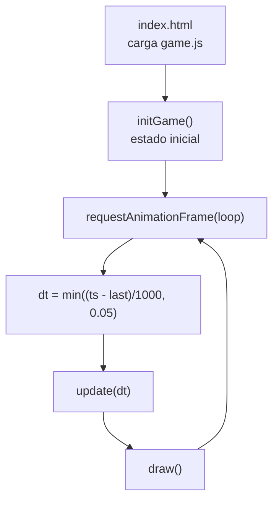
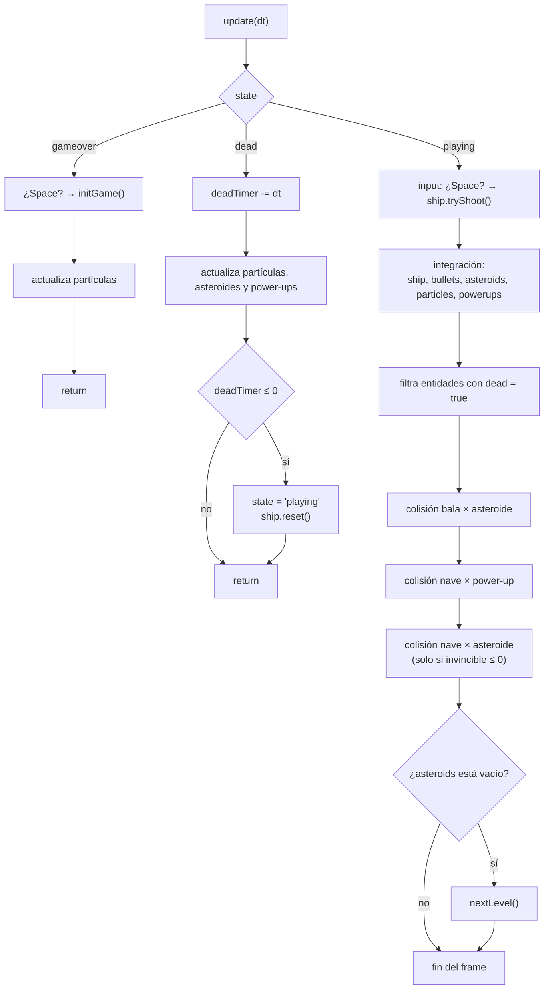
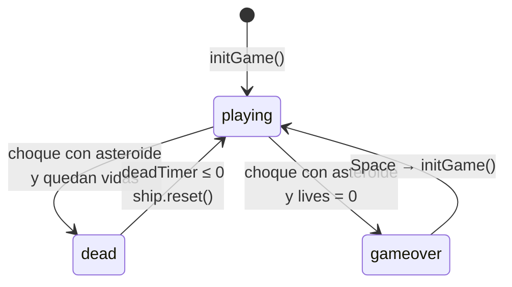
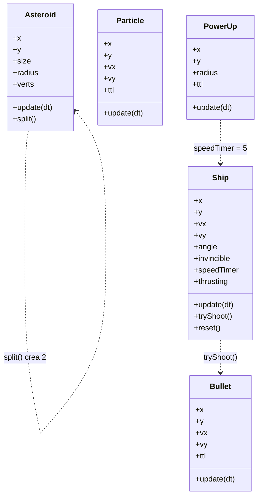
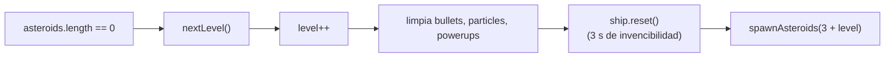

# Arquitectura

Documento de referencia de **cómo está armado y cómo fluye** el juego. Para el detalle de reglas y constantes, ver `README.md`; para advertencias de mantenimiento, `AGENTS.md`.

> Los diagramas usan **Mermaid**: se renderizan en GitHub/GitLab y en VS Code con la extensión Markdown Preview Mermaid Support. En un visor sin soporte solo se ve el código fuente de los bloques.

## Archivos

| Archivo | Contenido |
| --- | --- |
| `index.html` | Canvas fijo 800×600 y `<script src="game.js">` (script clásico, sin módulos) |
| `game.js` | Input, utilidades, 5 clases, estado global, update, draw y loop |
| `favicon.svg` | Ícono |

Todo vive en **un único scope global**: las clases y funciones se referencian directamente entre sí, sin imports.

## Arranque y loop principal

`initGame()` corre una sola vez al cargar y deja el juego en `'playing'`; no hay pantalla de título.



En código (`game.js:495-504`):

```js
function loop(ts) {
  const dt = lastTime === null ? 0 : Math.min((ts - lastTime) / 1000, 0.05);
  lastTime = ts;
  update(dt);
  draw();
  requestAnimationFrame(loop);
}
```

- `dt` es el tiempo real entre frames, **limitado a 0.05 s** (si el navegador se traba, nada se teletransporta).
- `update()` muta el estado; `draw()` solo lee. El loop no tiene lógica propia.

## Un frame de `update(dt)`

La función es una **máquina de estados con returns tempranos** (`game.js:356-429`). Según `state`, actualiza un subconjunto distinto de entidades.



> En `'dead'`, la nave y las balas quedan **congeladas**: las balas siguen dibujadas en pantalla pero nadie las actualiza, y solo siguen moviéndose asteroides, partículas y power-ups.

## Máquina de estados



| Estado | Qué se actualiza | Qué se dibuja | Cómo sale |
| --- | --- | --- | --- |
| `playing` | Todo | Todo + HUD | Muerte o nivel completado |
| `dead` | Partículas, asteroides, power-ups | Todo + HUD (nave oculta) | Timer de 2 s |
| `gameover` | Solo partículas | Todo + HUD + overlay | `Space` |

Detalle: `killShip()` (`game.js:343-353`) es el único punto que resta vidas; calcula el estado siguiente y arranca `deadTimer = 2`.

## Entidades y relaciones



Contrato común: cada clase expone `update(dt)`, `draw()` y un flag booleano `dead`. El `update` global llama a todas y luego hace `array = array.filter(e => !e.dead)` — no se eliminan objetos a mitad de iteración.

| Clase | Rol | Constantes asociadas |
| --- | --- | --- |
| `Ship` | Jugador: rota, acelera, dispara con cooldown | `ROT`, `THRUST`, `DRAG` dentro de `update()` |
| `Bullet` | Proyectil de vida corta con `wrap()` | `SPEED = 520`, `ttl = 1.1` |
| `Asteroid` | Roca poligonal irregular que se parte | `RADII`, `SPEEDS`, `POINTS` (`game.js:61-63`) |
| `Particle` | Escombro visual, sin colisión | `life = 0.4–1.1 s` |
| `PowerUp` | Bonus "velocidad" flotante | `POWERUP_*` (`game.js:122-126`) |

## Colisiones

Todo se resuelve cada frame en `update()`, con distancia entre centros (`dist()`, `game.js:28`):

| Colisión | Condición | Efecto |
| --- | --- | --- |
| Bala × asteroide | `dist(b, a) < a.radius` | Suma `POINTS[size]`, `explode()`, intenta `maybeDropPowerUp()` (14 %), parte la roca |
| Nave × power-up | `dist(ship, p) < ship.radius + p.radius` | `ship.speedTimer = 5` + partículas |
| Nave × asteroide | `dist(ship, a) < ship.radius + a.radius * 0.82` y `invincible ≤ 0` | `killShip()` |

Excepción importante: el mundo es **toroidal** (`wrap()` en cada movimiento), pero `dist()` es euclidiana, así que los objetos que se cruzan por los bordes **no colisionan**. Está documentado en `AGENTS.md` como limitación conocida.

## Progresión



- Cada asteroide grande destruido se parte en 2 medianos y cada mediano en 2 pequeños (`split()` devuelve `[]` en tamaño 1).
- `spawnAsteroids()` evita el centro de la pantalla (`SAFE_DIST = 130`) para no matar al jugador al reaparecer.
- El boost de velocidad **no sobrevive** a `ship.reset()`: morir o cambiar de nivel lo cancela.

## Render

`draw()` (`game.js:479-493`) limpia el canvas y pinta en este orden (de atrás hacia adelante):

```
partículas → asteroides → balas → power-ups → nave → HUD → overlay (solo gameover)
```

Cada entidad se dibuja con `ctx.save()` / `translate` / `rotate` / `stroke` / `ctx.restore()`, en estilo wireframe blanco; los power-ups son la única excepción de color (`#4df`) y la nave se tiñe igual mientras dura el boost.

## Cómo extender

Para agregar otro power-up (siguiendo el patrón actual):

1. Añadir un campo de efecto en `Ship` (timer) y consumirlo en `Ship.update`.
2. Darle un tipo/identidad a `PowerUp` para elegir el efecto al recoger (hoy el efecto está hardcodeado en la colisión).
3. Ajustar el `draw()` para diferenciarlo visualmente.
4. Documentar la mecánica en `README.md` (sección Power-ups) y el gotcha en `AGENTS.md`.

Para cambiar el balance: las constantes están agrupadas arriba de cada sección de `game.js`, y `DRAG`/`THRUST` están dentro de `Ship.update` — movelas con cuidado porque la física es dependiente del frame rate.
